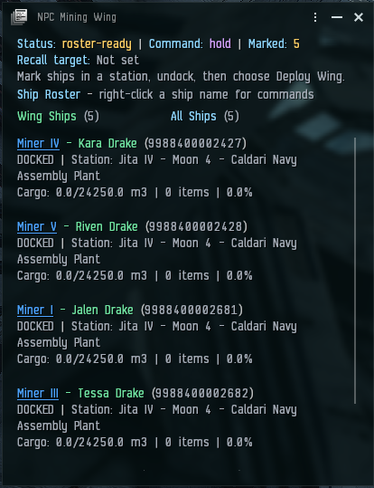

# NPC Mining Wing

[](LICENSE)
[](https://github.com/inerdy/NPC-Wing-Mining)
[](https://github.com/inerdy/NPC-Wing-Mining)
[](https://github.com/inerdy/NPC-Wing-Mining/commits/main)

NPC Mining Wing lets a player deploy up to six owned ships as a coordinated
NPC-controlled mining wing: five mining ships and one collection ship. Ships remain real owned hulls and use their fitted
modules, cargo holds, mining holds, drones, and the commanding pilot's skills.

## Features

- Mark ships in the station hangar and deploy them into the current system.
- Launch deployed ships from the station's native undock point before they join
  the player's active ship.
- Command the wing to follow, hold, mine, recall, or collect cargo.
- Use fitted mining modules and compatible mining or combat drones.
- Automatically return to unload when mining holds are full.
- Designate one marked ship as the collection ship so miners unload into it.
- Automatically send a full collection ship to its saved station, unload its
  mining cargo, and return it to the wing.
- Send the collection ship to its saved station to unload, then return it to the wing.
- Recall ships to their saved launch station, including across systems.
- Keep recall state authoritative when a solar-system scene is unloaded; ships
  become visible again when a player enters their current system.
- Show ship location, cargo, mining, drone, and combat status in the in-game UI.
- Send status and command messages through the private Wing Comms channel.
- Recover collection trips after temporary route, scene, docking, or leader failures
  with persisted retry state and backoff instead of retrying every runtime tick.
- Show collection retry details and lightweight runtime telemetry in the status panel.

The wing is limited to six NPC ships. The intended setup is five miners and one
collection ship. The player's active ship is not counted toward that limit.

## Requirements

- Native EveJS `0.12.9` — [EveJS Discord](https://discord.gg/WpYh9zpNrx)
- [EveJS Launcher `1.0.69`](https://github.com/V0nCleef/evejs-launcher/releases/tag/v1.0.69) or newer

This mod is native-only. Docker deployments are not supported.

## Installation

Copy or clone `npcMiningWing` into the EveJS `mods` directory. The manifest must
be located at:

```text
mods/npcMiningWing/evejs-launcher.mod.json
```

Enable the mod in the EveJS Launcher, apply the Game server restart, and open
the in-game **Mods** menu.

## Basic use

1. In a station, open **NPC Mining Wing** and mark owned ships.
2. Undock in the ship you want the wing to follow.
3. Deploy the marked ships.
4. Choose **Follow Wing**, **Hold Wing**, or **Mine Wing**.
5. Right-click one marked ship and choose **Set as Collection Ship**.
6. Use **Send Collection Ship to Station** when its hold needs to be unloaded.
7. Use **Recall Wing** to return all deployed ships to their saved launch station.

The collection ship does not mine. While the wing is mining, full mining ships
approach the collection ship and transfer their mining output to its appropriate
hold. The collection ship must be deployed and nearby for automatic transfers.
Its station trip uses the station where it was launched; the ship unloads mining
cargo into that station hangar before returning to the player's current system.

Deployment and recall use scene-aware presentation. When the player's current
space scene is available, a newly deployed ship appears at the station undock
point and travels toward the player, while a recalled ship remains visible
until it reaches docking range. When no player session has a scene loaded, the
wing keeps the ship's inventory-backed system and transit state instead of
creating an empty scene only for animation. The ship is materialized when a
player enters that system; visual absence in an unloaded scene does not mean
the ship has already docked.

There is no separate configuration file. The mod stores its state under the
active EveJS data root at `gameStore/npcMiningWing/state.json`.

The saved state is migrated forward when the schema changes. Runtime-only mining
deadlines are intentionally not persisted, so a server restart recalculates the
next mining cycle instead of replaying stale timers. Collection-trip retry counts
and the last retry error are persisted so a temporary failure remains visible and
does not become a tight retry loop.

If the JSON state file is malformed or uses an unsupported schema, the mod keeps a
timestamped `.corrupt-*` copy before repairing the active state file. This makes
recovery possible without blocking server startup.

## Host compatibility and development checks

Version 0.12.10 carries forward the validated player character ID from each
owned ship record through drone capability checks, launches, and commands. It
also explicitly patches the drone runtime export when the wing service acquires
it, so the bridge still attaches if another module loader replaces the mod's
load hook. Runtime identity fields are restored after each operation, preserving
the ships' unpiloted presentation. The scoped mining identity compatibility
layer and server-side hive ship identity registration remain active.

Detailed diagnostic streams now default to **off**. To enable a stream for a
test, set its variable to `1` in the game server process environment, then
restart the **Game server**:

- `NPC_MINING_WING_MINING_TRACE=1` enables mining-cycle, drone decision, and
  service-side defense diagnostics.
- `NPC_MINING_WING_DEFENSE_TRACE=1` enables runtime bridge, aggression, and
  owner-bound native drone-operation diagnostics.
- `NPC_MINING_WING_IDENTITY_TRACE=1` enables mining identity-hook diagnostics.

Leave these variables unset or set them to `0` to keep the corresponding logs
quiet. Disabling diagnostics does not disable the drone bridge, mining identity
compatibility, mining, or combat-defense behavior.

When enabled, `[NPCMiningWing:MiningTrace]` records include timestamps and
process IDs; paired calls share a `trace` ID and nested calls identify their
parent. Mining-cycle diagnostics include native preparation and cycle results,
cargo snapshots, and module-stop reasons. `drone.*` events report bay inventory
and candidate selection, launch and command results, periodic mining-drone cycle
state and ship output, defense threat evaluation, and drone return state. Records
include selected owner, ship, drone, target, command, activity, and cycle-time
fields, not whole sessions or native response objects.

`[NPCMiningWing:DefenseTrace]` reports hive-ship identity registration,
incoming-aggression tracking, and owner-bound native drone operations. Its
`runtime.patch` record states whether the drone runtime and incoming-aggression
hook were available; paired `incoming.before`/`incoming.after` records show the
resolved hive owner, attacker, and native aggression result. Repeated hits and
recurring samples are throttled. Each trace stream is capped at 300 lines per
second per process. The mining identity compatibility layer supplies the
validated owner character ID and persisted ship record for native wing mining,
then restores the entity's original runtime identity.

- `installed` reports the host root and whether dependencies were already cached.
  A late-install warning means some captured calls may bypass tracing.
- `hook.attached`, `hook.missing`, and `hook.failed` report instrumentation coverage.
- `heartbeat` runs every 10 seconds independently of the wing ticker. It shows
  hook status, callback and error counts (including zero), last service entry and
  completion times, scene/session counts when available, and active wing commands.
  Loader-only processes can emit startup banners without running the gameplay
  service; use the process ID and service timestamps to distinguish them.
- `ship.observe` records effect changes and samples each ship about every five
  seconds, including cycle deadlines, overdue duration, raw identity values and
  inventory. Missing values, nulls and numeric zero remain distinct. The native
  character ID prediction is labeled as a prediction, not an observed private call.
- `wingTick`, `prepare`, `cycle`, `activeShipLookup`, `fittingLookup`,
  `miningSnapshot`, `storageSnapshot`, `grant`, `sessionlessStop`, and module
  activation/deactivation events record `.before`, `.after`, or `.throw`.
  Ship selection and grant arguments come from the actual native calls.
- `[NPCMiningWing:MiningIdentity]` reports compatibility hook coverage, the
  owner and persisted ship record bound for each native preparation/cycle call,
  and explicit reasons when the owner or ship record cannot be validated.
- `cargoHandoff` and `cargoMove` trace unloading when reached. Cycle inventory
  snapshots omit the owner filter so grants to an unexpected owner are visible.

For a reproduction, deploy a miner and run mining undisturbed for at least three
full module cycles. Export the server log from startup through the failure,
including the heartbeat and native module-stop entries. Repeat with the same
character, fittings and game/mod versions locally and on the VPS to compare the
resolved identities and selected ship records. A visible laser animation alone
does not confirm a completed, successful cycle.

Diagnostics retain native results and errors and log only selected fields, never
whole sessions or sockets. Inventory samples are capped at 32 rows. A safeguard
caps ordinary trace output at 300 lines/second/process; `suppressed` in the
heartbeat explicitly reports any omitted lines. Within that limit native cycle
and stop calls are not sampled. Sampled wing ticks and heartbeats keep output
bounded between cycles. A stopped process or blocked event loop cannot emit a
heartbeat; no logger can guarantee output in those cases.

The loader validates the EveJS version and the native service seams it needs before
registering the mod. It currently requires EveJS `0.12.9` and the native backend;
unsupported layouts fail with a clear startup error.

From the `Server Mods` directory, run the package checks with:

```text
node npcMiningWing/test/validate.js
node --test npcMiningWing/test/loader.test.js npcMiningWing/test/state.test.js
```

Set `EVEJS_ROOT` when the EveJS checkout is not in the sibling directory expected
by the workspace tests. The loader smoke test can still validate the mod when host
dependencies are not installed; the deeper service-manager assertion runs once
those dependencies are available.

## In-game view



## Removal

Disable the mod in the Launcher and restart the Game server. Deployed ships
remain real inventory items. Do not delete the state file unless you intend to
reset the wing's saved metadata.

## License and maintenance

This project is released under the MIT License; see [LICENSE](LICENSE).

You may alter, maintain, and re-release the mod if it becomes unmaintained.
Please retain credit to the original author, **Troublesum**, in the source and
documentation.

## AI disclosure

Parts of this project were developed with assistance from AI tools. The code,
behavior, testing, documentation, and releases are reviewed and maintained by
Troublesum. AI assistance does not change the license or ownership of this
project.
